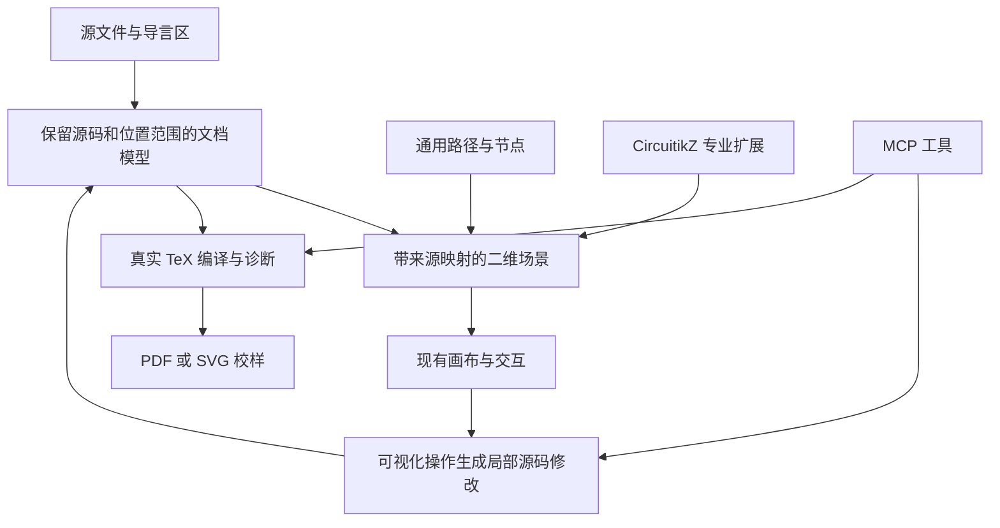

# TikZ 通用化评估与实测基线（实施前）

后续实施见 [第一阶段实施说明](TIKZ_GENERALIZATION_IMPLEMENTATION.md)。本文件保留最初评估时的结果。

日期：2026-10-27。对象：当前本地 CircuiTikZ-Designer 工作区。

可以在现有项目上发展通用 TikZ 工具。现有画布、选择、分组、吸附、属性、撤销、存档和 MCP 桥接可以复用。主要改造集中在文档模型、源码保留、样式与环境管理、路径语义和真实 TeX 预览；单独扩展元件库不足以满足目标。

建议定位为“支持可视化编辑与 MCP 的 TikZ 工作台”，将 CircuitikZ 保留为专业扩展。先覆盖二维教学和科研图，包括相量图、结构图、流程图、函数曲线和电路图。任意 TikZ 文档可以保留源码并在具备依赖时编译；逐对象可视化编辑需要逐步扩大支持范围。

## 本次完成的工作

- 检查当前模型、导入、导出、存档、全局设置和 MCP 实现。
- 重新构建当前网页；生产构建通过，存在现有 Sass 弃用提示。
- 新增可重复执行的语料审计脚本 `scripts/audit-tikz-generalization.cjs`。
- 通过正式 MCP SDK 的 stdio 连接、本机桥接和独立的无界面 Edge 会话测试语料，没有操作用户已打开的图纸。
- 对三组原图与导出结果执行 XeLaTeX 编译；检查成功编译的五张渲染图。
- 本次没有实现通用编辑器功能，也没有修改现有产品源码。语料源文件的前后 SHA-256 一致，导入器前后 SHA-256 一致。

## 语料和导入结果

语料目录：`E:\Projects\Thesis\电机学\review\figures`。

| 项目 | 数量 | 含义 |
| --- | ---: | --- |
| `.tex` 图形源文件 | 35 | 实际扫描结果 |
| 可独立输入的绘图环境 | 34 | 本次通过 MCP 逐幅测试 |
| 带参数的模板 | 1 | `assignment_phasors.tex`，含 `#1`–`#4`，不当作可独立绘图环境测试 |
| 无警告导入 | 23 | 只表示现有接口接受，不能视为保真通过 |
| 审核警告后导入 | 8 | 允许警告后仍有缺失 |
| 导入失败 | 3 | Color 创建错误 |

本次统一设置 `snapToGrid: false`，避免网格对齐改变原始几何。34 幅独立图中，6 幅使用坐标单位设置，9 幅使用循环，6 幅使用函数 `plot`，2 幅使用 `pgfmath`，3 幅使用贝塞尔曲线。28 幅引用自定义颜色，27 幅含中文，22 幅使用颜色混合。上述特征存在交集。

失败的三幅为 `dc_armature_structure.tex`、`shunt_dc_generator.tex`、`synchronous_structure.tex`，错误均为 `Unsupported string format, can't construct Color`。现有浏览器颜色处理不能完整承接 TikZ 的颜色语法。

模板的实际调用位于 `contents/07_assignment_examples.tex`，有三组参数。此轮仅做模板分类，没有把文本替换冒充 TeX 宏展开，也没有验证三组调用的可视化编辑。

## 发现的具体缺口

| 能力 | 实测现状 | 对通用化的影响 |
| --- | --- | --- |
| `x=2cm,y=1.15cm` | 最小测试无警告接受，但 `(1,1)` 按约 `(1cm,1cm)` 导入 | 图形比例会被静默改变 |
| `\foreach \k in {1,...,8}` | 仅创建 1 和 8 两个节点，并产生警告 | 绕组、刻度、阵列不完整 |
| `\pgfmathtruncatemacro` | 最小测试无警告接受，但文本仍为 `\lowerSlot`，未得到 9 | 计算标签和依赖它的坐标无法恢复 |
| `plot` 函数表达式 | 独立最小测试无法导入；实际图中的曲线被跳过 | 功角、饱和、空短路曲线缺失 |
| `\tikzset` 命名样式 | 最小测试无警告接受，但命名样式的红色、线宽和箭头未应用 | 风格继承和统一修改失效 |
| 裸颜色 `[red]` | 最小测试无警告接受，颜色丢失；`[draw=red]` 对照测试能保留 | 当前支持范围取决于具体写法 |
| 贝塞尔 `controls` | 转为 49 点折线并导出为折线 | 外观可近似，但控制点和原始曲线语义丢失 |
| 导言区宏、颜色、字体 | 当前存档没有通用的项目环境字段；片段预览不能自动取得宿主定义 | `\jj`、自定义色和中文字体需要环境管理 |
| 通用导出 | 普通相量图的导出仍带 `european voltages`、`voltage dir`、`\ctikzset` | 普通 TikZ 图也被带入电路环境依赖 |

三组 XeLaTeX 对照使用相同的测试导言区，补入宿主文档已有的 `amzchaptercolor` 和 `\jj`，并使用 Times New Roman / SimSun。测试没有复制原类文件的全部字体和版式，因此用于评估图形往返保真，不声称复现讲义整页排版。

| 图 | 原始片段 | 导出片段 | 视觉检查结论 |
| --- | --- | --- | --- |
| `power_angle.tex` | 编译、渲染通过 | 编译、渲染通过 | 三条曲线消失，坐标比例、颜色和文字排布改变；“能编译”不能证明保真 |
| `winding_connection_table.tex` | 编译、渲染通过 | 编译失败 | 导出的 `\lowerSlot` 未定义；浏览器预览仅有首尾两组连接 |
| `synchronous_phasor.tex` | 编译、渲染通过 | 编译、渲染通过 | 主体几何可辨认，但颜色、箭头和标签位置发生变化；原图导入没有警告 |

这些结果说明，首要要求应该是保留语义和准确报告支持范围。不能用导入对象数量、无警告、没有非有限坐标或编译成功代替保真验收。

## 建议的结构



### 1. 通用对象模型与专业扩展

复用 `CircuitComponent` 现有通用接口，逐步引入不依赖电路的抽象名称和数据类型，不立即全仓重命名。通用对象包括节点、文字、命名坐标、复合路径、贝塞尔控制点、圆弧、组、作用域和绘图曲线。

CircuitikZ 扩展提供符号库、引脚、`to[...]`、电压电流标注、全局电路设置和导出依赖。普通 TikZ 文档仅引入实际需要的宏包与库。既有 JSON 和 MCP 调用保持兼容，新增字段做版本化迁移。

### 2. 保留源码的文档模型

保留原始文本、注释、未知键和语法的起止位置，在可可靠解释的范围内建立语法树和场景映射。原始文本是导入文档的权威内容，场景是供交互使用的派生表示。

拖动已支持的节点时，修改对应坐标或作用域变换，避免把整幅图重新序列化成完全不同的 TikZ。命名坐标、样式和引用要保留依赖关系。对 `\foreach` 生成的对象，优先编辑循环参数或循环体；没有明确映射时提示编辑源码或整个源代码块，不把单个实例的拖动解释成任意源码修改。

编辑能力分级：

- 完整理解的对象提供控制点和属性编辑。
- 复杂但能隔离依赖的内容作为保留源码的块，通过参数或外层变换操作。
- 无法可靠隔离的内容按整幅图保留和编译，支持源码编辑与真实预览。

不支持的内容不能静默丢弃。用户应能在导入前看到保留、近似和不可编辑的范围。

### 3. 环境与真实编译

文档或项目需要保存编译引擎、宏包、TikZ 库、宏定义、自定义颜色、字体和资源目录。中文教学图优先以 XeLaTeX 做校样，保留可配置引擎。

现有 SVG 画布继续提供快速拖动反馈，真实 TeX 输出用于校样和最终导出验证。MCP 增加编译、读取诊断和获取校样的能力，结果注明使用的是画布预览还是 TeX 编译输出。

TikZ 的循环和数学表达式有正式的 TeX 宏与作用域语义，见 [PGF/TikZ 循环文档](https://tikz.dev/pgffor) 和 [数学表达式文档](https://tikz.dev/math-parsing)。由此作出的架构建议是：浏览器解析器负责明确的可编辑子集，真实 TeX 引擎负责完整执行和渲染，避免在前端逐项模拟整个 TeX 系统。

## 推进顺序与验收

| 阶段 | 交付内容 | 验收方式 |
| --- | --- | --- |
| 第一阶段：这批二维教学图 | 坐标单位与作用域矩阵、样式/颜色、原生曲线、项目导言区、循环与计算的明确支持策略、未知源码保留 | 35 个源文件全部进入语料清单；34 幅独立图和模板的三组实际调用各有明确支持级别；无静默缺失 |
| 第二阶段：源码与图形协同 | 保留源码的编辑、命名坐标依赖、循环参数编辑、真实编译与源码诊断 | 无修改导入导出保留原文；局部编辑只改变目标范围；编译后检查图形和文字 |
| 第三阶段：更广的扩展 | 流程图、树图、标注、绘图数据、PGFPlots 等扩展及 MCP 能力查询 | 各扩展有独立真实语料与视觉基线，电路回归持续通过 |

第一阶段优先修复静默丢失并建立保真底座，不以支持任意 TeX 的逐对象编辑为交付承诺。对循环和参数模板，“保留源码并能编译”可以先于“每个生成对象都能任意拖动”交付。

验收至少包括：原图与导出图均可在指定环境编译；比较曲线数量、坐标、标签、箭头和颜色；人工检查真实编译图；保留循环、公式和命名样式；未知语法有明确说明；既有电路的保存、撤销和 MCP 版本检查继续工作。导入科学图默认保留坐标，网格对齐由用户显式启用。

## 复现和证据

已有网页与 MCP 依赖、`.qa-tools/node_modules/playwright` 和本机 Edge 的当前环境中：

```powershell
npm run build
node scripts/audit-tikz-generalization.cjs 'E:\Projects\Thesis\电机学\review\figures' 'E:\Projects\Circuitikz\CircuiTikZ-Designer\qa-results\tikz-generalization-new-run'
```

输出目录必须不存在，并位于语料目录之外，防止覆盖基线或写入原稿。浏览器测试使用临时端口和独立会话。审计是表征脚本，发现不支持的能力会记录为 `preserved: false`，不把它伪装成断言通过；如需用于 CI，还需按阶段目标增加明确的通过门槛。

- [完整结果及源文件哈希](qa-results/tikz-generalization-20261027/results.json)
- [XeLaTeX 对照结果](qa-results/tikz-generalization-20261027/latex-results.json)
- 各样本子目录含 `input.tikz`、`export.tikz`、`components.json`、`document.json`；代表样本另有浏览器 PNG 与 `latex/` 下的 TeX、日志、PDF 和 PNG。编译失败的绕组导出没有 PDF。
- [语料审计脚本](scripts/audit-tikz-generalization.cjs)
- [编译复现脚本](qa-results/tikz-generalization-20261027/compile-comparison.cjs)

本轮只对三组片段进行了真实 TeX 对照，其余图仅完成导入、模型和导出表征。没有完成全语料的视觉验收，也没有验证任意第三方 TikZ 库。
